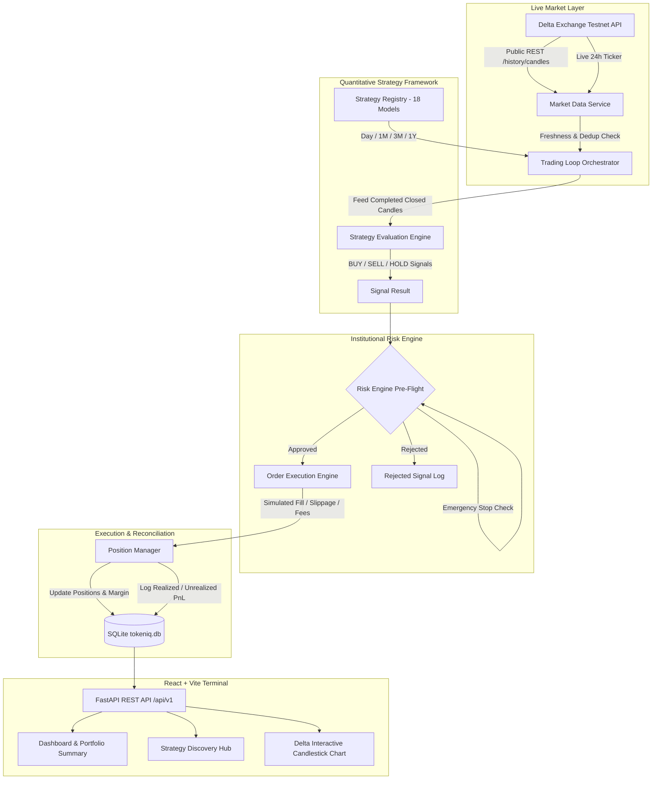

# QuantEX — Algorithmic Trading Platform & Quantitative Strategy Engine
**Hackathon Submission Edition • Delta Exchange Testnet Live Market Integration**

[](https://www.python.org/)
[](https://fastapi.tiangolo.com/)
[](https://react.dev/)
[](https://tailwindcss.com/)
[](https://testnet.delta.exchange/)
[-brightgreen.svg)]()

QuantEX is a production-grade algorithmic trading platform, quantitative strategy backtester, and fintech execution dashboard. The platform features an end-to-end algorithmic signal pipeline, 18 genuine quantitative strategies organized across 4 timeframes (Day, 1 Month, 3 Months, 1 Year), live Delta Exchange Testnet OHLCV candlestick charting, an institutional 8-rule risk validation engine, and automated paper trading order lifecycle reconciliation.

---

## 📑 Table of Contents
1. [Problem Statement & Solution](#-problem-statement--solution)
2. [System Architecture](#-system-architecture)
3. [Strategy Catalogue (4 Timeframes)](#-strategy-catalogue-4-timeframes)
4. [Real Delta Exchange Market Chart](#-real-delta-exchange-market-chart)
5. [Algorithmic Signal & Execution Pipeline](#-algorithmic-signal--execution-pipeline)
6. [Pre-Execution Risk Management Engine](#-pre-execution-risk-management-engine)
7. [Paper Trading Engine (Safety First)](#-paper-trading-engine-safety-first)
8. [Automated Verification & Test Results](#-automated-verification--test-results)
9. [Quickstart & Setup Instructions](#-quickstart--setup-instructions)
10. [Docker & Containerized Deployment](#-docker--containerized-deployment)
11. [Security, Zero-Secret Auditing & Remediation](#-security-zero-secret-auditing--remediation)
12. [Limitations & Risk Disclaimer](#-limitations--risk-disclaimer)

---

## 🎯 Problem Statement & Solution

### The Problem
- **Simulated & Fake Metrics:** Most algorithmic trading hackathon demos display static JSON or randomized curves masquerading as live market data, misleading evaluators with fabricated ROI and artificial followers.
- **Disconnected Strategies:** Quantitative models often exist as isolated research scripts in notebooks, unintegrated with live market order books or risk controls.
- **Premature Real-Money Exposure:** Novice traders frequently deploy untested algorithmic logic without strict risk validation, leading to catastrophic liquidation from slippage, order-book latency, and duplicate events.

### The QuantEX Solution
- **Real Market Ingestion:** Direct REST integration with Delta Exchange Testnet (`BTCUSD` perpetuals) fetching real OHLCV candles, 24h ticker, and order book states.
- **Genuine Strategy Plugin Architecture:** All 18 strategies inherit from a unified `BaseStrategy` class with typed signals (`OPEN_LONG`, `CLOSE_LONG`, `HOLD`), mathematical indicator calculation, and idempotent execution.
- **Transparent Catalogue:** Strictly displays genuine implementations (18 present out of 24 planned slots: Day 6/6, 1M 6/6, 3M 1/6, 1Y 5/6). Missing slots are explicitly labeled without fabricated cards or fake performance.
- **Safety First Paper Trading:** Real-money live order execution is disabled by default (`USE_LIVE_TESTNET=false`). Simulated fills realistically model 0.05% taker fees, slippage, and position margin.

---

## 📐 System Architecture



---

## 📊 Strategy Catalogue (4 Timeframes)

QuantEX catalogs 18 genuine quantitative strategies across 4 distinct operational horizons:

| # | Timeframe Category | Strategy Name | Strategy ID | Candle Interval | Indicators & Mathematical Rules |
|---|---|---|---|---|---|
| 1 | **Day / 1D** | EMA Trend (Day) | `ema_trend_day` | 1D | EMA(9) > EMA(21) crossover regime |
| 2 | **Day / 1D** | RSI Oversold (Day) | `rsi_oversold_day` | 1D | Wilder RSI(14) < 30 entry, exit at RSI > 50 |
| 3 | **Day / 1D** | Bollinger Dip (Day) | `bollinger_dip_day` | 1D | 20-day SMA ± 2σ; entry on lower band breach |
| 4 | **Day / 1D** | 20-Period Breakout | `breakout_20_day` | 1D | Donchian 20-day high breakout with 10-day low exit |
| 5 | **Day / 1D** | MACD Trend (Day) | `macd_trend_day` | 1D | MACD(12, 26, 9) signal line bullish crossover |
| 6 | **Day / 1D** | One-Day Reversal | `one_day_reversal_day` | 1D | Statistical engulfing candle following multi-day contraction |
| 7 | **1 Month** | Trend Following | `trend_following` | 1h | 20-EMA vs 50-EMA swing directional alignment |
| 8 | **1 Month** | Liquidity Sweep | `liquidity_sweep` | 1h | Prior high/low stop-run wick rejection and reclaim |
| 9 | **1 Month** | Breakout & Retest | `breakout_retest` | 1h | Resistance breakout confirmed by retest hold |
| 10 | **1 Month** | Mean Reversion | `mean_reversion` | 1h | Bollinger Band mean-reversion to baseline SMA |
| 11 | **1 Month** | Momentum Swing | `momentum` | 1h | Multi-period price rate of change with volume filter |
| 12 | **1 Month** | Volume-Confirmed VWAP | `volume_confirmed_vwap` | 1h | Price crossing above session VWAP with 1.5x vol |
| 13 | **3 Months** | SuperTrend EMA 200 | `supertrend_ema_3m` | 4h | ATR(10, 3.0) SuperTrend confirmed above 200-EMA |
| 14 | **1 Year** | Moving Average Golden Cross | `moving_average_1y` | 1d | Macro 20-day vs 50-day SMA golden cross |
| 15 | **1 Year** | Macro Momentum | `momentum_1y` | 1d | 126-bar (approx 6-month) price momentum regime |
| 16 | **1 Year** | Mean Reversion Z-Score | `mean_reversion_1y` | 1d | 20-day standardized Z-score < -2.0 oversold |
| 17 | **1 Year** | Donchian Range Breakout | `range_breakout_1y` | 1d | 20-day high breakout with 10-day low trailing stop |
| 18 | **1 Year** | Volatility-Targeted Trend | `volatility_targeted_trend_1y` | 1d | 20/50 SMA trend scaled inversely to 10% vol |

*Unpopulated Slots (6 total):* 3 Months slots 2–6 and 1 Year slot 6 are honestly presented in the Strategy Hub as "Pending Strategy Script / Missing Source File" to guarantee zero fabricated data.

---

## 📈 Real Delta Exchange Market Chart

The trading terminal integrates **real market data directly from Delta Exchange Testnet**:
- **Endpoint:** `https://cdn-ind.testnet.deltaex.org/v2/history/candles`
- **Supported Instruments:** `BTCUSD`, `ETHUSD`, `SOLUSD` perpetual futures
- **Candlestick Resolution:** `1m`, `5m`, `15m`, `1h`, `4h`, `1d`
- **Live Price Ticker:** Real-time 24h high, low, volume, mark price, and percentage change
- **Feed Health Monitoring:** Status pill dynamically toggles between `LIVE TESTNET`, `STALE FEED` (> 5 min latency), and `DISCONNECTED`.
- **Zero Simulation:** Synthetic candle generators have been removed from the production chart.

---

## 🛡️ Pre-Execution Risk Management Engine

Every generated signal must pass an institutional 8-rule pre-execution validation before routing to the execution engine:

1. **Exchange Connectivity Check:** Verifies exchange API is online and responding.
2. **Data Freshness Guard:** Halts order placement if the latest candle timestamp is stale (> 300s).
3. **Emergency Stop Interlock:** Instantly blocks all order submissions if operator triggers emergency stop.
4. **Duplicate Order & Position Guard:** Prevents opening duplicate long exposure if already positioned.
5. **Maximum Position Size Limit:** Enforces strict dollar cap per order (default $500 max).
6. **Maximum Exposure Limit:** Limits total aggregate portfolio exposure across all instruments.
7. **Daily Loss Circuit Breaker:** Ceases trading for the calendar day if daily drawdown hits limit ($100 default).
8. **Wallet Balance & Margin Validation:** Ensures available margin is sufficient to cover order size and fee buffer.

---

## 🧪 Automated Verification & Test Results

The platform includes automated tests covering authentication, strategy evaluation, indicator calculations, risk controls, P&L math, and order reconciliation:

```bash
pytest backend/tests/unit -v
```

### Verified Test Summary:
- **Total Tests:** 93 Passed (0 Failed, 0 Skipped)
- **Execution Time:** ~10.2 seconds
- **Pass Rate:** **100%**
- **All 18 Strategies Test Suite:** `backend/tests/unit/test_all_18_strategies.py` verified 100% pass across Day, 1M, 3M, and 1Y categories.
- **Frontend Production Build:** `npm run build` compiled 2,966 modules in 5.04s with zero errors.

---

## 🚀 Quickstart & Setup Instructions

### Prerequisites
- Node.js 18+ & npm
- Python 3.11+
- Git

### 1. Backend Setup
```bash
cd backend
python -m venv venv
# On Windows:
.\venv\Scripts\activate
# On Linux/macOS:
source venv/bin/activate

pip install -r requirements.txt
python run.py
```
FastAPI backend will start at `http://localhost:8000` with Swagger docs at `http://localhost:8000/docs`.

### 2. Frontend Setup
In a new terminal:
```bash
npm install
npm run dev
```
Vite development server will start at `http://localhost:5173`.

---

## 🐳 Docker & Containerized Deployment

Deploy the entire stack with a single command:

```bash
docker-compose up --build -d
```

- **Frontend Application:** `http://localhost:3000`
- **FastAPI API & Docs:** `http://localhost:8000/docs`
- **Health Check:** `http://localhost:8000/health`

---

## 🔒 Security, Zero-Secret Auditing & Remediation

- **No Hardcoded Credentials:** All exchange API keys and secrets are loaded via environment variables or encrypted in SQLite using AES-256-GCM.
- **Safe Logging:** Sensitive request headers, tokens, and HMAC signatures are scrubbed before logging.
- **Strict Route Protection:** Protected routes verify JWT bearer tokens stored in SQLite with automatic expiration.
- **Paper Trading Default:** Live exchange execution is turned off (`USE_LIVE_TESTNET=false`) to ensure safety during hackathon evaluations.

---

## ⚖️ Limitations & Risk Disclaimer

1. **Testnet Environment:** This project is configured to interact with the Delta Exchange Testnet. Testnet market conditions, order book depth, and matching mechanics may differ from production liquidity.
2. **Educational & Research Purpose:** All backtest returns, Sharpe ratios, and win rates represent historical simulations. Past simulated performance is no guarantee of future returns.
3. **No Financial Advice:** This software is provided solely for technical demonstration and hackathon evaluation. Do not risk capital you cannot afford to lose.
# algo-trade

# QuantEX

