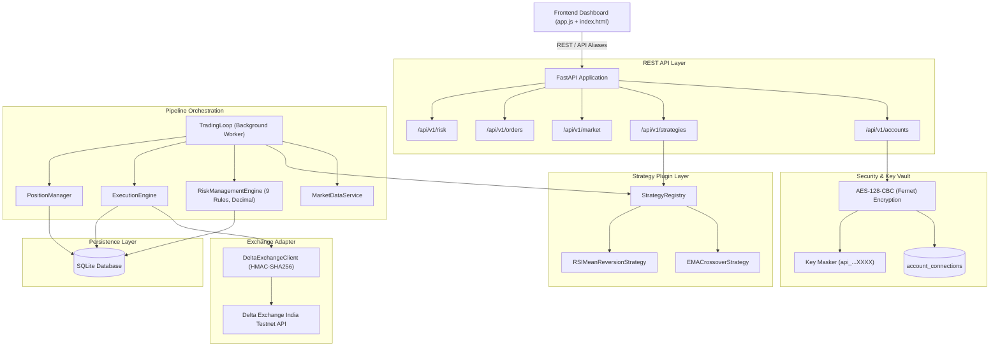

# QuantEX — System Architecture

This document outlines the architecture, data flow, component boundaries, and security model of QuantEX.

---

## 1. High-Level System Architecture

---

## 2. Core Components

### 2.1 Strategy Plugin Architecture (`app/strategies/`)
- **`BaseStrategy`**: Abstract class defining the lifecycle: `validate_config`, `compute_indicators`, `generate_signal`.
- **`StrategyRegistry`**: Singleton registry storing strategy classes and instances. Supports dynamic parameter updates and enable/disable states.
- **`StrategySignalResult`**: Immutable dataclass standardizing signal outputs across all strategies with deterministic IDs:
  $$\text{sig\_id} = \text{sig\_}\{strategy\}\_\{instrument\}\_\{timeframe\}\_\{candle\_ts\}\_\{type\}$$

### 2.2 Risk Management Engine (`app/services/risk_engine.py`)
Enforces 9 deterministic rules using Python `Decimal` precision:
1. **Emergency Stop**: Blocks if manual or system emergency stop is active.
2. **Connectivity**: Blocks if Delta Exchange is unreachable.
3. **Freshness**: Rejects candles older than `MAX_DATA_AGE_SECONDS + interval`.
4. **Actionable Filter**: Rejects `HOLD` signals from execution.
5. **Daily Loss Limit**: Computes realized P&L from SQLite `trades` table since `00:00:00 UTC`. Survived across restarts.
6. **Max Open Orders**: Blocks if open orders $\ge 3$.
7. **Long-Only Policy**: Prevents duplicate long entries; prevents naked shorting.
8. **Position Exposure**: Prevents total position size $> 0.20$ BTC.
9. **Margin Verification**: Ensures wallet available balance $\ge$ required margin.

### 2.3 Exchange Adapter (`app/exchange/`)
- **`auth.py`**: Computes official Delta Exchange signatures:
  $$\text{signature} = \text{HMAC-SHA256}(\text{secret}, \text{METHOD} + \text{TIMESTAMP} + \text{PATH} + \text{COMPACT\_BODY})$$
- **`client.py`**: Handles rate limits (HTTP 429), server errors (HTTP 5xx), auth rejections (HTTP 401), and simulation fallback when `use_live=False`.
- **`manager.py`**: Dynamically creates a per-user `DeltaExchangeClient` using decrypted credentials from the database.

### 2.4 Order Execution & Reconciliation (`app/services/execution_engine.py`)
- State machine: `PENDING_SUBMIT` $\to$ `SUBMITTED` $\to$ `OPEN` $\to$ `FILLED` / `REJECTED` / `CANCELLED`.
- Ambiguous responses (timeouts) move orders to `RECONCILING`. Blind resubmissions are prohibited; status is queried before state transition.
